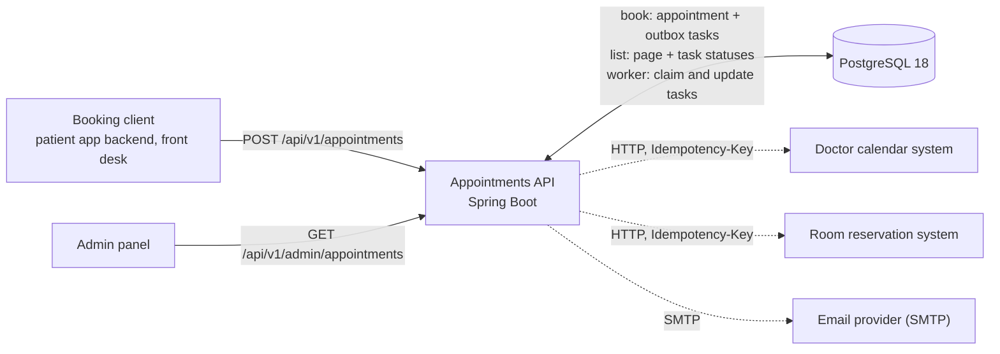
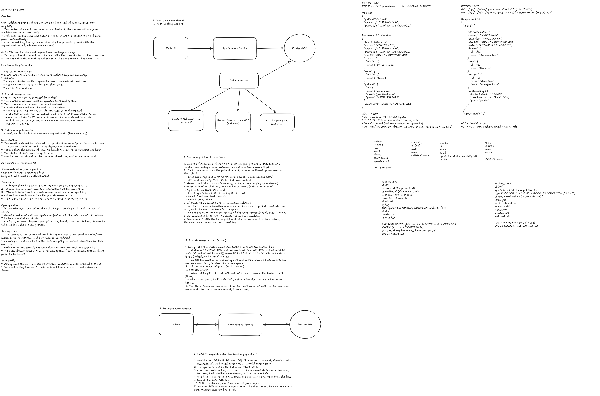

# Appointments API

Patients book medical appointments. The service picks a free doctor of the requested specialty and
a free room, **never overbooking either**, confirms the booking at once, and then updates the doctor's
calendar, reserves the room in external systems and emails the patient. Admins list all
appointments, with the status of those follow-up actions.

Design: [docs/HLD.md](docs/HLD.md) · Decisions: [DECISIONS.md](DECISIONS.md) ·
Implementation plan: [docs/PLAN.md](docs/PLAN.md) · Rules for contributors (and the AI): [CLAUDE.md](CLAUDE.md)

**Contents:** [Quick start](#quick-start) · [Architecture](#architecture) ·
[Run the tests](#run-the-tests) · [Run locally](#run-locally) ·
[Reset the database](#reset-the-database-for-a-demo) · [Calling the API](#calling-the-api) ·
[Configuration](#configuration) · [Operating the service](#operating-the-service) ·
[Runbook](#runbook-failed-post-booking-tasks) · [Conformance](#conformance-invariants-and-decisions--tests) ·
[Project structure](#project-structure) · [How to extend](#how-to-extend) ·
[Design history](#design-history-the-original-sketch) · [How AI was used](#how-ai-was-used)

## Quick start

With Docker Desktop running:

```bash
docker compose up --build
```

When <http://localhost:8080/actuator/health/readiness> answers `{"status":"UP"}`, book an appointment:

```bash
curl -i -u booking-client:booking-local -H 'Content-Type: application/json' -d '{"patientId":"00000000-0000-0000-0000-000000000001","specialty":"CARDIOLOGY","startAt":"2030-01-07T14:00:00Z"}' http://localhost:8080/api/v1/appointments
```

Then see the confirmation email in Mailpit (<http://localhost:8025>), the calendar and room calls
in WireMock (<http://localhost:8089/__admin/requests>), and the appointment in the admin listing:

```bash
curl -u admin:admin-local http://localhost:8080/api/v1/admin/appointments
```

## Architecture

One Spring Boot service and one PostgreSQL database; no message broker (D-014).



- **Booking** validates the request, picks a doctor and a room, and writes the appointment and its
  three post-booking tasks in one transaction; the response does not wait for any external system.
- **The outbox worker** (every 2 s) claims due tasks, calls the external systems (dashed lines),
  retries with backoff and marks each task `DONE` or `FAILED`.
- **The admin listing** reads appointments page by page, with the status of each task.

The components inside the service are in [HLD §5](docs/HLD.md#5-architecture).

The guarantees, and what enforces them (HLD §2):

| # | Invariant | Enforced by |
|---|-----------|-------------|
| I1 | A doctor never has two overlapping active appointments | PostgreSQL partial unique index on (doctor, slot start) — D-002 |
| I2 | A room never has two overlapping active appointments | Same, on (room, slot start) |
| I3 | The assigned doctor has the requested specialty | Allocation only considers doctors of that specialty |
| I4 | A confirmed appointment never loses its post-booking actions | Transactional outbox: tasks written in the booking's transaction — D-004 |
| I5 | A patient never has two overlapping active appointments (so client retries are safe) | Same unique index, on (patient, slot start) — D-011 |

Key choices: the database is the source of truth and the booking returns `201` without waiting for
external systems (D-001); slots are fixed 30-minute blocks on the :00/:30 UTC grid (D-007); conflicts
between concurrent requests are resolved by the database and retried, not by locks (D-002, D-003);
external calls are retried by the outbox with backoff, failures classified as retryable or not
(D-005, D-017). The [HLD](docs/HLD.md) explains each flow and the [decision log](DECISIONS.md) the
options considered.

## Prerequisites

- Java 25 (`JAVA_HOME` pointing to a JDK 25)
- Docker Desktop (running): the tests use Testcontainers, and the local stack runs in Docker

Maven is not required: the project ships with the Maven Wrapper.

## Run the tests

macOS / Linux:

```bash
./mvnw verify
```

Windows (PowerShell or cmd):

```powershell
.\mvnw.cmd verify
```

`verify` runs every test (unit and integration, against a real PostgreSQL 18, WireMock and
GreenMail) and checks formatting (Spotless + google-java-format). To fix formatting:
`./mvnw spotless:apply` (or `.\mvnw.cmd spotless:apply`).

## Run locally

### Everything in Docker

```bash
docker compose up --build
```

This starts the application (profile `local`), PostgreSQL, WireMock (the doctor calendar and room
reservation systems) and Mailpit (a fake SMTP server):

| What | Where |
|------|-------|
| API and Swagger UI | <http://localhost:8080>, <http://localhost:8080/swagger-ui.html> |
| Emails sent to patients | Mailpit UI: <http://localhost:8025> |
| Calls to the calendar and room systems | WireMock request journal: <http://localhost:8089/__admin/requests> |

If port 8080 is taken (for example by the app running from the IDE), publish the API on another
port: `APP_PORT=18080 docker compose up --build`.

### Reset the database (for a demo)

`docker compose up --build` rebuilds the application but keeps the PostgreSQL container, and with it
every appointment booked so far. To start from an empty database:

```bash
docker compose down -v
docker compose up --build
```

`down` removes the containers and `-v` the database's storage, so the next start seeds a fresh random
dataset (D-024): the same six specialties and three demo patients, new random doctors, rooms and
patients. Check it with the admin listing, which returns `{"items":[],"nextCursor":null}`:

```bash
curl -s -u admin:admin-local http://localhost:8080/api/v1/admin/appointments
```

### From the IDE or the command line

1. Start the dependencies:

   ```bash
   docker compose up -d postgres wiremock mailpit
   ```

2. Start the application with the `local` profile, either from the command line:

   ```bash
   ./mvnw spring-boot:run -Dspring-boot.run.profiles=local
   ```

   or from **IntelliJ IDEA**:

   1. Open the project as a Maven project and make sure the project SDK is JDK 25
      (File → Project Structure → Project).
   2. Open `AppointmentsApiApplication` and click the green arrow next to `main` → *Modify Run
      Configuration…* (or Run → Edit Configurations → + → Spring Boot).
   3. Set **Active profiles** to `local` (if the field is hidden: Modify options → Add VM
      options → `-Dspring.profiles.active=local`, or Environment variables →
      `SPRING_PROFILES_ACTIVE=local`).
   4. Run or Debug.

The `local` profile connects to the Docker containers, creates random sample data on the first
start and defines the credentials below.

## Calling the API

Two endpoints, one per functional requirement (D-015). Timestamps are ISO-8601 UTC.

### Credentials

Callers authenticate with **HTTP Basic** (D-012): send the user and password on every request, there
is no token to generate. The role comes from the user:

| User | Password (`local` profile) | Role | Can call |
|------|----------------------------|------|----------|
| `booking-client` | `booking-local` | `BOOKING_CLIENT` | `POST /api/v1/appointments` |
| `admin` | `admin-local` | `ADMIN` | `GET /api/v1/admin/appointments` |

Outside the `local` profile the passwords come from `BOOKING_CLIENT_PASSWORD` and `ADMIN_PASSWORD`.
In production the same roles would be mapped from JWTs issued by the platform identity provider.

### Sample data

On an empty database the `local` profile creates the six specialties (`CARDIOLOGY`, `DERMATOLOGY`,
`GENERAL_PRACTICE`, `PEDIATRICS`, `ORTHOPEDICS`, `NEUROLOGY`), 3–5 random doctors per specialty,
10 rooms, 200 random patients and three demo patients with fixed ids (D-024):

| Patient | Id |
|---------|----|
| Demo Patient 1 | `00000000-0000-0000-0000-000000000001` |
| Demo Patient 2 | `00000000-0000-0000-0000-000000000002` |
| Demo Patient 3 | `00000000-0000-0000-0000-000000000003` |

### Swagger UI

Open <http://localhost:8080/swagger-ui.html>. In the `local` profile the page opens without login:
click **Authorize**, enter `booking-client` / `booking-local`, then open *POST /api/v1/appointments* →
*Try it out* → *Execute*. To list appointments, authorize as `admin` / `admin-local` and use
*GET /api/v1/admin/appointments*. The OpenAPI document is at <http://localhost:8080/v3/api-docs>
(D-026). In other profiles both require credentials.

### Book an appointment: `POST /api/v1/appointments`

`startAt` must be in the future, in UTC, on the :00 / :30 grid. There is no booking horizon and no
calendar: weekends, holidays and night hours are accepted (HLD A3, D-008). Replace the dates below if
they have passed.

```bash
curl -i -u booking-client:booking-local -H 'Content-Type: application/json' -d '{"patientId":"00000000-0000-0000-0000-000000000001","specialty":"CARDIOLOGY","startAt":"2030-01-07T14:00:00Z"}' http://localhost:8080/api/v1/appointments
```

On Windows PowerShell use `curl.exe` (plain `curl` is an alias of another command), or Git Bash, or
Swagger UI.

`201 Created`, with the whole appointment, so no follow-up call is needed (there is no `Location`
header and no read-by-id endpoint, D-015):

```json
{
  "id": "2c28df78-1600-403a-800b-7d20f5ae923e",
  "status": "CONFIRMED",
  "specialty": "CARDIOLOGY",
  "startAt": "2030-01-07T14:00:00Z",
  "endAt": "2030-01-07T14:30:00Z",
  "doctor": { "id": "41b32958-a4f4-4a95-bb9e-82f8466ec341", "name": "Dr. Alana Mohr" },
  "room": { "id": "005a26f6-d2ec-44f2-8d85-bdab9be1e93c", "name": "Room 8" },
  "patient": {
    "id": "00000000-0000-0000-0000-000000000001",
    "name": "Demo Patient 1",
    "email": "demo.patient1@example.com",
    "phone": "+351910000001"
  },
  "createdAt": "2026-10-14T10:59:18.186245Z"
}
```

The doctor is the one of that specialty with the fewest appointments that day (ties: lowest id); the
room is the first free one (D-009). Sending **the same request again** (same patient, slot and
specialty) is safe: it returns `201` with the same body and books nothing new (D-011).

#### Every error, with an example

Errors are RFC 9457 problem details (`application/problem+json`). Identify them by `code`; `title` is
the HTTP status phrase and `detail` explains the case. To try them, define a helper in Bash
(Git Bash on Windows):

```bash
book() { curl -s -u booking-client:booking-local -H 'Content-Type: application/json' -d "$1" http://localhost:8080/api/v1/appointments; echo; }
```

| Status | `code` | When | Request (`book '…'`) |
|--------|--------|------|----------------------|
| 400 | `VALIDATION_ERROR` | A field is missing, empty or malformed | `{}` |
| 400 | `SLOT_IN_PAST` | `startAt` is not in the future | `startAt` = `2020-01-07T14:00:00Z` |
| 400 | `SLOT_NOT_ALIGNED` | `startAt` is not on :00 or :30 UTC | `startAt` = `2030-01-07T14:15:00Z` |
| 401 | — | No or wrong credentials | (call without `-u`) |
| 403 | — | Credentials without the `BOOKING_CLIENT` role | (call with `-u admin:admin-local`) |
| 404 | `PATIENT_NOT_FOUND` | Unknown `patientId` | a random UUID |
| 404 | `SPECIALTY_NOT_FOUND` | Unknown specialty code | `specialty` = `ASTROLOGY` |
| 409 | `PATIENT_ALREADY_BOOKED` | The patient has another appointment at that slot | same patient and slot, another specialty |
| 409 | `NO_DOCTOR_AVAILABLE` | Every doctor of the specialty is booked at that slot | see below |
| 409 | `NO_ROOM_AVAILABLE` | Every room is booked at that slot | see below |
| 500 | — | An unexpected error; `detail` reveals nothing internal | — |
| 503 | — | PostgreSQL is unavailable; nothing was booked, retry later | stop the `postgres` container |

```bash
book '{}'
```

```json
{"title":"Bad Request","status":400,"code":"VALIDATION_ERROR","detail":"patientId must not be null; specialty must not be blank; startAt must not be null","instance":"/api/v1/appointments"}
```

A body that is not valid JSON, or a field of the wrong type (e.g. `"patientId":"not-a-uuid"`), gives
the same code with `"detail":"Request body is missing or malformed"`.

```bash
book '{"patientId":"00000000-0000-0000-0000-000000000001","specialty":"CARDIOLOGY","startAt":"2020-01-07T14:00:00Z"}'
```

```json
{"title":"Bad Request","status":400,"code":"SLOT_IN_PAST","detail":"Slot 2020-01-07T14:00:00Z is not in the future","instance":"/api/v1/appointments"}
```

```bash
book '{"patientId":"00000000-0000-0000-0000-000000000001","specialty":"CARDIOLOGY","startAt":"2030-01-07T14:15:00Z"}'
```

```json
{"title":"Bad Request","status":400,"code":"SLOT_NOT_ALIGNED","detail":"Slot 2030-01-07T14:15:00Z is not aligned to the 30-minute grid","instance":"/api/v1/appointments"}
```

```bash
curl -i -H 'Content-Type: application/json' -d '{}' http://localhost:8080/api/v1/appointments
```

```
HTTP/1.1 401
WWW-Authenticate: Basic realm="appointments-api"

{"title":"Unauthorized","status":401,"detail":"Authentication is required","instance":"/api/v1/appointments"}
```

```bash
curl -s -u admin:admin-local -H 'Content-Type: application/json' -d '{}' http://localhost:8080/api/v1/appointments
```

```json
{"title":"Forbidden","status":403,"detail":"Access is denied","instance":"/api/v1/appointments"}
```

```bash
book '{"patientId":"9b2f6a3e-1c4d-4e5f-8a7b-0c1d2e3f4a5b","specialty":"CARDIOLOGY","startAt":"2030-01-07T15:00:00Z"}'
```

```json
{"title":"Not Found","status":404,"code":"PATIENT_NOT_FOUND","detail":"Patient 9b2f6a3e-1c4d-4e5f-8a7b-0c1d2e3f4a5b not found","instance":"/api/v1/appointments"}
```

```bash
book '{"patientId":"00000000-0000-0000-0000-000000000001","specialty":"ASTROLOGY","startAt":"2030-01-07T15:00:00Z"}'
```

```json
{"title":"Not Found","status":404,"code":"SPECIALTY_NOT_FOUND","detail":"Specialty ASTROLOGY not found","instance":"/api/v1/appointments"}
```

After booking Demo Patient 1 in `CARDIOLOGY` at `2030-01-07T14:00:00Z` (the first example), the same
patient and slot with another specialty:

```bash
book '{"patientId":"00000000-0000-0000-0000-000000000001","specialty":"DERMATOLOGY","startAt":"2030-01-07T14:00:00Z"}'
```

```json
{"title":"Conflict","status":409,"code":"PATIENT_ALREADY_BOOKED","detail":"The patient already has another appointment at 2030-01-07T14:00:00Z","instance":"/api/v1/appointments"}
```

`NO_DOCTOR_AVAILABLE` and `NO_ROOM_AVAILABLE` need more patients than the three demo ones; take
random ones from the database. A specialty has at most 5 doctors, so six patients exhaust it:

```bash
patients=$(docker compose exec -T postgres psql -U appointments -d appointments -tAc "SELECT id FROM patient WHERE name NOT LIKE 'Demo%' LIMIT 11" | tr -d '\r')
for p in $(echo "$patients" | head -6); do book "{\"patientId\":\"$p\",\"specialty\":\"NEUROLOGY\",\"startAt\":\"2030-01-08T09:00:00Z\"}"; done
```

```json
{"title":"Conflict","status":409,"code":"NO_DOCTOR_AVAILABLE","detail":"No NEUROLOGY doctor is free at 2030-01-08T09:00:00Z","instance":"/api/v1/appointments"}
```

There are 10 rooms; spreading 11 bookings over the specialties fills every room before any
specialty runs out of doctors:

```bash
specialties=(CARDIOLOGY DERMATOLOGY GENERAL_PRACTICE PEDIATRICS ORTHOPEDICS NEUROLOGY); i=0
for p in $patients; do book "{\"patientId\":\"$p\",\"specialty\":\"${specialties[i++ % 6]}\",\"startAt\":\"2030-01-08T10:00:00Z\"}"; done
```

```json
{"title":"Conflict","status":409,"code":"NO_ROOM_AVAILABLE","detail":"No room is free at 2030-01-08T10:00:00Z","instance":"/api/v1/appointments"}
```

With the database down (`docker compose stop postgres`; `docker compose start postgres` to recover),
every request that needs it answers within a few seconds, and nothing is half-written (HLD §12):

```bash
book '{"patientId":"00000000-0000-0000-0000-000000000002","specialty":"CARDIOLOGY","startAt":"2030-02-04T10:00:00Z"}'
```

```json
{"title":"Service Unavailable","status":503,"detail":"The service is temporarily unavailable","instance":"/api/v1/appointments"}
```

### List appointments: `GET /api/v1/admin/appointments`

All appointments, sorted by `startAt` and then `id`, one page at a time (D-016). Query parameters:

| Parameter | Default | Meaning |
|-----------|---------|---------|
| `limit` | `20` | Page size, 1–100 |
| `cursor` | — | `nextCursor` from the previous page; omit it for the first page |

```bash
curl -s -u admin:admin-local 'http://localhost:8080/api/v1/admin/appointments?limit=20'
```

`200 OK`:

```json
{
  "items": [
    {
      "id": "2c28df78-1600-403a-800b-7d20f5ae923e",
      "status": "CONFIRMED",
      "specialty": "CARDIOLOGY",
      "startAt": "2030-01-07T14:00:00Z",
      "endAt": "2030-01-07T14:30:00Z",
      "doctor": { "id": "41b32958-a4f4-4a95-bb9e-82f8466ec341", "name": "Dr. Alana Mohr" },
      "room": { "id": "005a26f6-d2ec-44f2-8d85-bdab9be1e93c", "name": "Room 8" },
      "patient": {
        "id": "00000000-0000-0000-0000-000000000001",
        "name": "Demo Patient 1",
        "email": "demo.patient1@example.com"
      },
      "postBooking": { "doctorCalendar": "DONE", "roomReservation": "DONE", "email": "DONE" }
    }
  ],
  "nextCursor": "eyJzdGFydEF0IjoiMjAzMC0wMS0wN1QxNDowMDowMFoiLCJpZCI6IjJjMjhkZjc4LTE2MDAtNDAzYS04MDBiLTdkMjBmNWFlOTIzZSJ9"
}
```

For the next page, send `nextCursor` back as `cursor` (`limit` may change between pages). Stop when
`nextCursor` is `null`: that was the last page. With no appointments, `items` is `[]`.

```bash
curl -s -u admin:admin-local 'http://localhost:8080/api/v1/admin/appointments?limit=20&cursor=eyJzdGFydEF0IjoiMjAzMC0wMS0wN1QxNDowMDowMFoiLCJpZCI6IjJjMjhkZjc4LTE2MDAtNDAzYS04MDBiLTdkMjBmNWFlOTIzZSJ9'
```

- Treat the cursor as opaque: do not build or edit it. Its format may change.
- Pages stay consistent while new appointments are booked: walking every page returns each appointment
  exactly once. There is no total count and no "jump to page N" (D-016).
- `postBooking` shows each post-booking action: `PENDING` (not done yet, or being retried), `DONE`
  or `FAILED` (needs a person: see the [runbook](#runbook-failed-post-booking-tasks)).

#### Every error, with an example

| Status | `code` | When |
|--------|--------|------|
| 400 | `INVALID_CURSOR` | The cursor is malformed (not a `nextCursor` returned by this API) |
| 400 | `VALIDATION_ERROR` | `limit` is not a number between 1 and 100 |
| 401 | — | No or wrong credentials |
| 403 | — | Credentials without the `ADMIN` role |
| 500 | — | An unexpected error; `detail` reveals nothing internal |
| 503 | — | PostgreSQL is unavailable; retry later |

```bash
curl -s -u admin:admin-local 'http://localhost:8080/api/v1/admin/appointments?cursor=abc'
```

```json
{"title":"Bad Request","status":400,"code":"INVALID_CURSOR","detail":"The cursor is malformed; use the nextCursor of a previous response","instance":"/api/v1/admin/appointments"}
```

```bash
curl -s -u admin:admin-local 'http://localhost:8080/api/v1/admin/appointments?limit=0'
```

```json
{"title":"Bad Request","status":400,"code":"VALIDATION_ERROR","detail":"limit must be greater than or equal to 1","instance":"/api/v1/admin/appointments"}
```

`limit=abc` gives the same code with `"detail":"limit has an invalid value"`; `limit=101` with
`"detail":"limit must be less than or equal to 100"`.

```bash
curl -s -u booking-client:booking-local http://localhost:8080/api/v1/admin/appointments
```

```json
{"title":"Forbidden","status":403,"detail":"Access is denied","instance":"/api/v1/admin/appointments"}
```

Without credentials: `401` with `WWW-Authenticate: Basic realm="appointments-api"`, as for booking.

## Configuration

All settings live in `src/main/resources/application.yaml`; the `local` profile
(`application-local.yaml`) supplies local defaults. Secrets and addresses come from environment
variables:

| Variable | Used for | `local` default |
|----------|----------|-----------------|
| `DB_URL`, `DB_USERNAME`, `DB_PASSWORD` | PostgreSQL | `jdbc:postgresql://localhost:5432/appointments`, `appointments`, `appointments` |
| `BOOKING_CLIENT_PASSWORD`, `ADMIN_PASSWORD` | HTTP Basic passwords of the two callers | `booking-local`, `admin-local` |
| `CALENDAR_BASE_URL` | Doctor calendar system | `http://localhost:8089` (WireMock) |
| `ROOMS_BASE_URL` | Room reservation system | `http://localhost:8089` (WireMock) |
| `SMTP_HOST`, `SMTP_PORT` | SMTP server | `localhost`, `1025` (Mailpit) |
| `EMAIL_FROM` | Sender of the confirmation email | `appointments@clinic.local` |
| `SPRING_MAIL_USERNAME`, `SPRING_MAIL_PASSWORD` | SMTP credentials, if the provider needs them | — |
| `SPRING_PROFILES_ACTIVE` | `local` for local runs (seeder, open Swagger UI) | — |
| `APP_PORT` | Host port of the app in `docker-compose.yml` only | `8080` |

Behaviour settings (any of them can be overridden with an environment variable, e.g.
`APPOINTMENTS_OUTBOX_MAX_ATTEMPTS=5`):

| Setting | Default | Meaning |
|---------|---------|---------|
| `appointments.booking.max-retries` | `2` | Retries after losing a slot to a concurrent request (3 attempts in total, D-003) |
| `appointments.outbox.enabled` | `true` | Run the outbox worker on this instance |
| `appointments.outbox.poll-interval` | `2s` | Pause between worker polls |
| `appointments.outbox.batch-size` | `20` | Tasks claimed per poll |
| `appointments.outbox.lease` | `30s` | How long a claimed task is reserved; keep it longer than the HTTP timeouts |
| `appointments.outbox.max-attempts` | `10` | Attempts before a task is `FAILED` |
| `appointments.outbox.initial-backoff` / `max-backoff` | `5s` / `10m` | First retry delay / cap |
| `appointments.outbox.backoff-multiplier` / `backoff-jitter` | `2` / `0.2` | Exponential growth / ±20 % randomness |
| `spring.http.clients.connect-timeout` / `read-timeout` | `2s` / `5s` | Calendar and room calls |
| `spring.mail.properties[mail.smtp.*timeout]` | `2000` / `5000` / `5000` ms | SMTP connect / read / write |
| `appointments.email.time-zone` | `Europe/Lisbon` | Time zone of the date and time in the confirmation email, e.g. `Atlantic/Azores` (D-027); the API and the database stay in UTC |
| `appointments.security.public-api-docs` | `false` (`true` in `local`) | Swagger UI and `/v3/api-docs` without login |
| `appointments.seed.*` (`local` only) | 3–5 doctors per specialty, 10 rooms, 200 patients | Sample data size |

With the defaults, a task that keeps failing with retryable errors is `FAILED` after about
30 minutes (5 s, 10 s, 20 s … capped at 10 min, 10 attempts).

## Operating the service

### Health probes

| Endpoint | Checks | Use |
|----------|--------|-----|
| `GET /actuator/health/liveness` | The application only | Restart the instance when it fails |
| `GET /actuator/health/readiness` | The application and PostgreSQL | Stop sending traffic when it fails |

Both are public and answer `{"status":"UP"}`; with credentials they also list the components
checked. External systems (calendar, rooms, SMTP) are never part of health: when one is down, the
outbox keeps retrying and the service stays available (D-001).

### Metrics

Under `/actuator/metrics` (any valid credentials), e.g.
`curl -u admin:admin-local http://localhost:8080/actuator/metrics/appointments.bookings`:

| Metric | Type | Tags | What it tells |
|--------|------|------|---------------|
| `appointments.bookings` | Timer | `outcome`: `BOOKED`, `REPEATED`, an error `code` (e.g. `NO_DOCTOR_AVAILABLE`), `ERROR` | Booking volume, latency and outcomes; `NO_*_AVAILABLE` is a capacity signal |
| `appointments.booking.conflicts` | Counter | `resource`: `doctor`, `room`, `patient` | Attempts that lost a slot to a concurrent request (contention, D-003) |
| `appointments.outbox.oldest.pending.age` | Gauge (seconds) | — | How late post-booking actions are — **alert candidate** |
| `appointments.outbox.failed` | Gauge | `type`: `DOCTOR_CALENDAR`, `ROOM_RESERVATION`, `EMAIL` | Tasks that need a person — **alert candidate** |

Spring Boot's own metrics are there too (`http.server.requests`, JVM, connection pool).
`appointments.bookings` counts requests that reach the service; requests rejected before it
(`VALIDATION_ERROR` on the body, 401, 403) show in `http.server.requests`. Alert thresholds are left
to be set once real traffic is observed (HLD §13).

### Logs and request ids

Every response carries an `X-Request-Id` header: the caller's value when it sends a safe one
(up to 64 letters, digits, `.`, `_` or `-`), otherwise a generated UUID. Every log line written while
handling the request carries it: as a `requestId` JSON field in the container (structured logs,
Elastic Common Schema), and as `[request-id]` in plain-text logs from the IDE. Logs contain ids only,
never patient names, emails, phones or specialties (health data, HLD §8).

## Runbook: FAILED post-booking tasks

A booking is confirmed in our database even when the calendar, room or email step fails (D-001).
Each of those steps is a row in `outbox_task`; `FAILED` means retrying will not fix it on its own.

**1. Notice it.** `appointments.outbox.failed` is above 0, or `appointments.outbox.oldest.pending.age`
keeps growing; the log has `Outbox task … FAILED after N attempts with …`; the admin listing shows
`FAILED` in `postBooking`.

**2. Inspect.** Locally:

```bash
docker compose exec postgres psql -U appointments -d appointments -c "SELECT id, appointment_id, type, attempts, updated_at, left(last_error, 200) AS last_error FROM outbox_task WHERE status = 'FAILED' ORDER BY updated_at;"
```

**3. Find the cause** in `last_error`:

| `last_error` | Meaning | Action |
|--------------|---------|--------|
| HTTP 400/404/409/422… | The external system rejected the request (D-017): retrying cannot help | Fix the data or agree with the system's owner; then re-drive |
| HTTP 5xx, 429, timeout, connection error | The system was down for longer than the retries (~30 min) | Check the system is healthy again; then re-drive |
| SMTP `5xx` (e.g. `550`) | The email provider rejected the address or message | Check the patient's email in the patient registry; then re-drive |

**4. Re-drive** once the cause is fixed. One task:

```bash
docker compose exec postgres psql -U appointments -d appointments -c "UPDATE outbox_task SET status = 'PENDING', attempts = 0, next_attempt_at = now(), last_error = NULL WHERE id = '<task id>' AND status = 'FAILED';"
```

Every failed task of one type, after an outage of that system:

```bash
docker compose exec postgres psql -U appointments -d appointments -c "UPDATE outbox_task SET status = 'PENDING', attempts = 0, next_attempt_at = now(), last_error = NULL WHERE type = 'ROOM_RESERVATION' AND status = 'FAILED';"
```

Re-driving is safe: calendar and room calls carry the appointment id as `Idempotency-Key`, so a
repeated call has no extra effect (HLD A7). A `FAILED` email was rejected by the provider or never
reached it; only in the rare case of a timeout after the provider accepted it can a re-drive send it twice.

**5. Check.** Within a few seconds the task is `DONE` (admin listing or the query above) and the
metrics go back to 0.

If tasks stay `PENDING` with nothing `FAILED` and nothing in the logs, check that at least one
instance runs the worker (`appointments.outbox.enabled`).

## Conformance: invariants and decisions → tests

Each guarantee and each decision that can be checked by a test, with the tests that prove it (test
names are their `@DisplayName`).

| Invariant / decision | Proven by |
|----------------------|-----------|
| **I1** doctor never double-booked | `AppointmentOverlapTest` "I1: a doctor is never double-booked"; `ConcurrentBookingTest` "I1, I2: 20 parallel requests for one slot get exactly min(doctors, rooms) bookings"; `BookAppointmentTest` "I1: when every doctor of the specialty is booked, the request gets NO_DOCTOR_AVAILABLE" |
| **I2** room never double-booked | `AppointmentOverlapTest` "I2: a room is never double-booked"; `ConcurrentBookingTest` (same as I1); `BookAppointmentTest` "I2: when every room is booked, the request gets NO_ROOM_AVAILABLE" |
| **I3** doctor of the requested specialty | `BookAppointmentTest` "I3: a booking is confirmed with a doctor of the requested specialty, a room and the patient" |
| **I4** post-booking actions never lost | `BookAppointmentTest` "I4: the new appointment has exactly three PENDING outbox tasks"; `OutboxWorkerTest` "I4: after a booking, calendar and room each get one request keyed by the appointment id", "I4: after a 503 or a timeout, the task is DONE once the system recovers"; `ConfirmationEmailTest` "I4: after a booking, the patient gets one email…", "I4: while SMTP is unavailable the email is retried, then sent once it recovers"; `OutboxClaimTest` "HLD 6.2: a task whose lease expired (crashed worker) is claimed again" |
| **I5** patient never double-booked | `AppointmentOverlapTest` "I5: a patient is never double-booked"; `ConcurrentBookingTest` "I5: 10 parallel identical requests create one appointment and all get it back"; `DuplicateBookingTest` (D-011 below) |
| D-001 201 while externals are down | `OutboxWorkerTest` "D-001: booking returns 201 while both external systems are down" |
| D-002 unique indexes, fixed slots | `AppointmentOverlapTest` "D-002: a start off the 30-minute grid is rejected by the database", "D-002: an appointment that is not 30 minutes long is rejected…", "Back-to-back slots are accepted…", "Cancelled appointments do not block a slot" |
| D-003 bounded retry on conflict | `RetryExhaustionTest` "D-003: a request that runs out of attempts gets a 409, never a server error"; `ConcurrentBookingTest` |
| D-004 outbox, claim with lease | `OutboxClaimTest` "D-004: concurrent claims never return the same task", "A claimed task gets a lease from the database clock…", "An outcome recorded with an expired lease changes nothing" |
| D-005 retries in the outbox, bounded | `OutboxWorkerTest` "D-005: a task that keeps failing is FAILED after the maximum attempts"; `RetryPolicyTest` (backoff growth, cap, jitter) |
| D-006 ports + real adapters | `OutboxWorkerTest` (HTTP adapters against WireMock), `ConfirmationEmailTest` (SMTP adapter against GreenMail) |
| D-007 30-minute grid | `SlotPolicyTest` "D-007: a future slot on the grid is accepted", "D-007: a slot off the 30-minute grid is rejected"; `BookAppointmentTest` SLOT_IN_PAST / SLOT_NOT_ALIGNED |
| D-008 no opening hours, no horizon | `SlotPolicyTest` "D-008: any future slot on the grid is bookable: weekends, nights, holidays, 2099" |
| D-009 least-booked doctor, first room | `BookAppointmentTest` "D-009: with two free doctors, the one with fewer appointments that day is chosen", "D-009: with equally loaded doctors, the lowest id is chosen" |
| D-010 patient by id | `BookAppointmentTest` "An unknown patient is rejected with PATIENT_NOT_FOUND" |
| D-011 retries are safe | `DuplicateBookingTest` "D-011: repeating a request returns 201 with the same appointment and creates nothing", "D-011: the same slot with another specialty is rejected with PATIENT_ALREADY_BOOKED" |
| D-012 roles per endpoint | `BookAppointmentTest` "D-012: ADMIN credentials cannot book (403)", "D-012: BOOKING_CLIENT credentials cannot reach the admin listing (403)"; `AppointmentListingTest` "D-012: BOOKING_CLIENT credentials cannot list appointments (403)" |
| D-015 only the FR endpoints | `BookAppointmentTest` "D-015: the 201 carries the whole appointment and no Location: there is no read-by-id" |
| D-016 keyset pagination | `AppointmentListingTest` "D-016: walking all pages returns every appointment once…", "D-016: an appointment inserted before the cursor causes no duplicates or skips", "The last page has nextCursor null…"; `CursorCodecTest` |
| D-017 retryable vs non-retryable | `RetryPolicyTest` (HTTP and SMTP classification table); `OutboxWorkerTest` "D-017: an external 4xx fails the task immediately…", "D-017: a 503 or a timeout keeps the task PENDING…"; `ConfirmationEmailTest` "D-017: a permanent SMTP rejection fails the email task without retrying" |
| D-020 JPA rules (schema validation, no N+1) | `OutboxTaskMappingTest` "Hibernate validates all entities against the Flyway schema"; `AppointmentListingTest` "No N+1: the number of SQL statements per page does not depend on page size" |
| D-024 local sample data | `LocalDataSeederTest` (counts, fixed demo ids, no duplicates on restart); `LocalDataSeederInactiveTest` "D-024: the seeder is not active outside the local profile" |
| D-025 application-assigned ids | `BaseEntityTest` "D-025: saving a new entity with an application-assigned id is one INSERT, no SELECT" |
| D-026 OpenAPI and Swagger UI | `OpenApiDocumentationTest`, `OpenApiPublicDocumentationTest` |
| D-027 patient-facing times in Lisbon time | `ConfirmationEmailTest` "D-027: the email shows Lisbon time: summer time is UTC+1, even across midnight" (and the winter case in the I4 email test) |
| HLD §12 database down | `DatabaseUnavailableTest` (booking and listing answer 503 problem detail within seconds, readiness fails); `UnexpectedErrorTest` (500 problem detail without internal details) |
| HLD §13 operability | `ObservabilityTest` (metric names and values, probes), `RequestIdTest` (request id echoed and in logs) |

The other decisions are about the shape of the project rather than behaviour, and are checked by
the build itself: Java 25 and Spring Boot 4.1 (D-018, D-019: the build fails on an older JDK), one
deployable with PostgreSQL (D-013, D-014), packages by feature (D-021), behaviour-based tests
against real infrastructure (D-022: the suite above), Spotless and CI (D-023: `verify` fails on
unformatted code).

## Project structure

```
src/main/java/pt/paulotrevizan/appointments/
  booking/        POST /appointments: controller and DTOs (api), BookingService, AllocationPolicy,
                  SlotPolicy, retry on conflict (application), Appointment (domain),
                  AppointmentRepository with the availability and listing queries (persistence)
  admin/          GET /admin/appointments: AppointmentListingController, AppointmentListingService,
                  CursorCodec
  postbooking/    OutboxWorker, task handlers, RetryPolicy, outbox metrics; OutboxTask and its repository
  integration/    calendar/, room/ (HTTP service clients), email/ (SMTP) — one port each
  catalog/        reference data: Patient, Doctor, Room, Specialty; LocalDataSeeder (profile local)
  common/         web (errors as RFC 9457, request id, OpenAPI), security, persistence (BaseEntity),
                  config (Clock)
src/main/resources/
  application*.yaml, db/migration/ (Flyway, schema only)
src/test/java/…   same packages; integration tests run against Testcontainers PostgreSQL 18
docker/wiremock/  WireMock mappings for the local calendar and room systems
docs/             HLD.md (current design), PLAN.md, the original design sketch (history only)
```

Each feature uses the same layers — `api` → `application` → `domain` / `persistence` — and
controllers never call repositories (D-021, [CLAUDE.md](CLAUDE.md)).

## How to extend

Start from the design: add or change the decision in [DECISIONS.md](DECISIONS.md) and the
[HLD](docs/HLD.md) first, then the code (the workflow in [CLAUDE.md](CLAUDE.md)).

- **A new post-booking action** (e.g. an SMS): add a value to `OutboxTaskType`, a Flyway migration
  that extends the `outbox_task_type_check` constraint, a port and adapter in `integration/`, a task
  handler and its case in `OutboxWorker.dispatch`, and its failure classification in `RetryPolicy`.
  `PostBookingTasks` already creates one task per type in the booking transaction.
- **Cancellation**: `Appointment.cancel(...)` and the `CANCELLED` status exist, and the slot indexes
  only cover `CONFIRMED` rows, so a cancelled slot is free again. What is missing is the endpoint and
  the outbox tasks that undo the calendar event and the room reservation and notify the patient.
- **Filters on the admin listing** (date range, doctor…): add them to the keyset queries, keeping the
  `(start_at, id)` order so the cursor stays valid, and add the indexes they need (D-015, D-016).
- **Another calendar, room or email provider**: implement the port (`DoctorCalendarGateway`,
  `RoomReservationGateway`, `EmailSender`); nothing else changes (D-006).
- **JWT instead of HTTP Basic**: replace `httpBasic` with an OAuth2 resource server in
  `SecurityConfig` and map the token's roles to `BOOKING_CLIENT` / `ADMIN`; the per-endpoint rules do
  not change (D-012).
- **Variable durations**: revisit D-002 — overlap is then no longer "same start", so the unique
  indexes must go back to exclusion constraints.

## Design history: the original sketch

The solution started as a sketch in Excalidraw: the problem statement, invariants, open questions,
the three flows, API payloads and a first data model on one board
([docs/original-design-sketch.png](docs/original-design-sketch.png)).

> **Historical, not current.** The sketch is kept as drawn to show where the design came from. The
> current design is [docs/HLD.md](docs/HLD.md), and every change since is recorded in
> [DECISIONS.md](DECISIONS.md). Do not build against the sketch.



Most of the core ideas survived: our database as the source of truth, a transactional outbox with
three independent tasks claimed with `FOR UPDATE SKIP LOCKED` and a lease, cursor pagination for the
admin listing, and the shape of both payloads. What changed during development, and why:

| In the sketch | Implemented | Why |
|---------------|-------------|-----|
| A repeated request returns `200` | `201` with the same body as the original response | Same response however many times it is sent; clients need no special case (D-011) |
| Overlaps blocked by `EXCLUDE USING gist` on a `slot tstzrange` column | Partial unique indexes on (doctor / room / patient, `start_at`) plus `CHECK` constraints that fix the 30-minute duration and the grid; `slot` dropped (migration `V2`) | Under 20 parallel requests the exclusion constraints deadlocked; unique indexes fail cleanly (D-002, measured) |
| On a conflict, drop that candidate and try the next one | Each attempt is a new transaction with fresh candidates, retried up to 3 times by Spring's `@Retryable` | Simpler and correct under contention; an identical request finds the winner's appointment (D-003) |
| `FAILED` "after N attempts (TBD)", every failure retried | 10 attempts, backoff 5 s × 2 capped at 10 min with ±20 % jitter; HTTP 4xx and SMTP 5xx fail at once | Retrying a rejection only delays the alert (D-005, D-017) |
| Errors described by HTTP status | A stable `code` per error in RFC 9457 problem details | Clients branch on `code`, not on text (HLD §7) |
| Index on `start_at` | Index on (`start_at`, `id`) | `id` breaks ties so pages never skip or repeat rows (D-016) |
| An external "E-mail Service API" | SMTP behind the `EmailSender` port; Mailpit and GreenMail stand in for it | The statement allows a fake SMTP service (HLD §7.3) |
| The patient calls the service | Platform components call it with per-endpoint roles; patients authenticate upstream | No end-user identity in this service (HLD A6, D-012) |
| — | Health probes, metrics, request ids, JSON logs | Operability (HLD §13) |

## How AI was used

I used AI (Anthropic's Claude) in two ways. In both, the decisions and the trade-offs are mine.

- **Design.** I analysed the problem and drew a first high-level design
  ([docs/original-design-sketch.png](docs/original-design-sketch.png)). Then, I explored and
  challenged the first idea and options for each decision with AI. Every decision and the trade-offs I accepted
  with each of them, are recorded in [DECISIONS.md](DECISIONS.md) and the [HLD](docs/HLD.md).
- **Implementation.** Claude Code implemented [docs/PLAN.md](docs/PLAN.md) one step at a time,
  under the rules I set in [CLAUDE.md](CLAUDE.md): one branch and one pull request per step, the
  scope and acceptance criteria restated before coding, `./mvnw verify` green before opening the
  pull request and each acceptance criteria mapped to the tests that prove it. I made explicit rules that did not
  allow it to change an invariant or a decision, add a dependency, push to `main` or merge.

I reviewed and merged every pull request. My review feedback came back as new commits on the same
branch: for example, replacing hand-written `RestClient` adapters with Spring Boot HTTP service
clients, naming the admin listing classes after their use case and also, documenting each new endpoint
in this README. I believe that what makes the AI-written code trustworthy for this problem is the test suite: 
it asserts behaviour against real infrastructure, ensuring not mocks of our own classes and it was the definition 
of done for every step.
