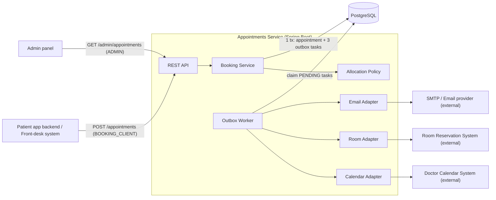
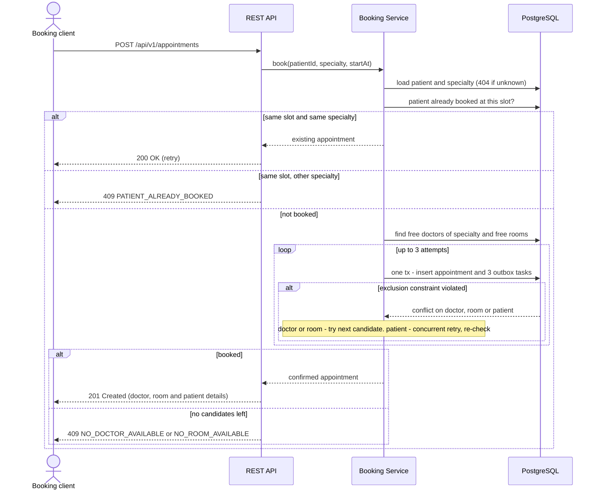
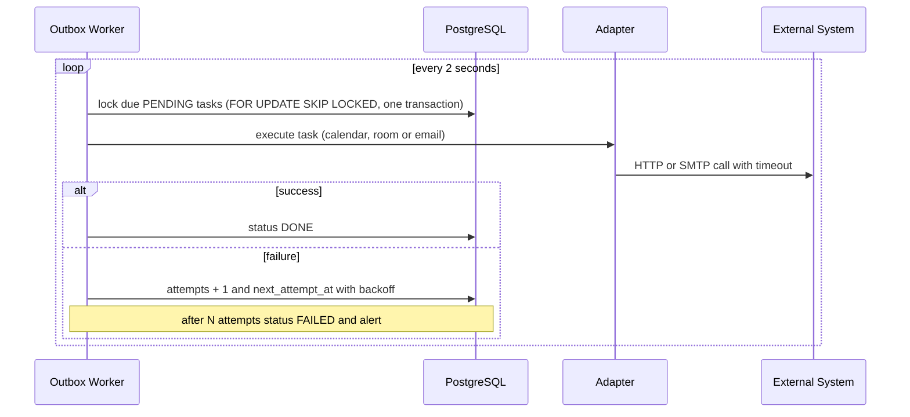
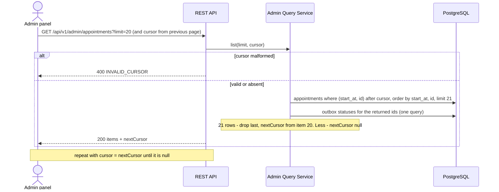
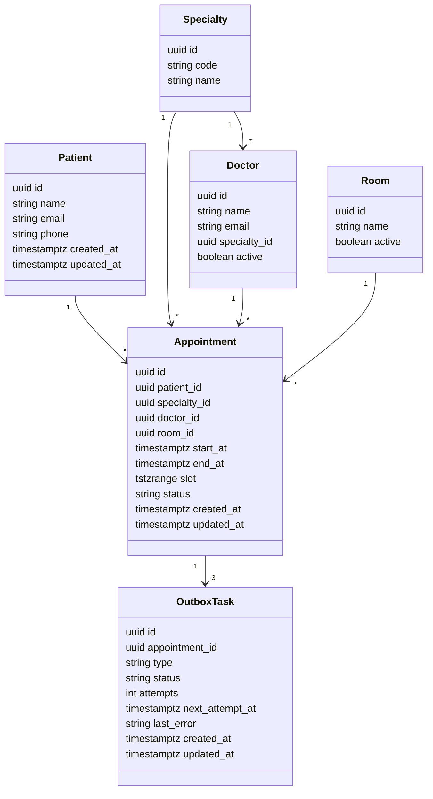

# Diagrams for Excalidraw

Paste each block into Excalidraw → **More tools → Mermaid to Excalidraw**.
Flowcharts become editable shapes; sequence and class diagrams are converted as far as
Excalidraw supports them — adjust styling by hand afterwards.

## 1. Architecture (components + external systems)

## 2. Create appointment (synchronous)

## 3. Post-booking actions (asynchronous)

## 4. List appointments — admin (cursor pagination)

## 5. Data model

Constraints to annotate on the drawing:
- `Appointment`: no overlap of (`doctor_id`, `slot`) for CONFIRMED — **I1**
- `Appointment`: no overlap of (`room_id`, `slot`) for CONFIRMED — **I2**
- `Appointment`: no overlap of (`patient_id`, `slot`) for CONFIRMED — **I5**
- `OutboxTask`: unique (`appointment_id`, `type`)
